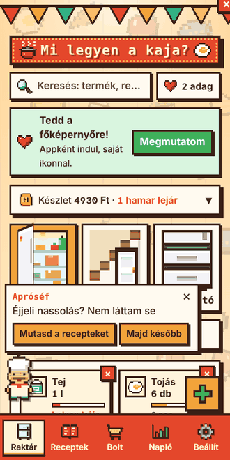
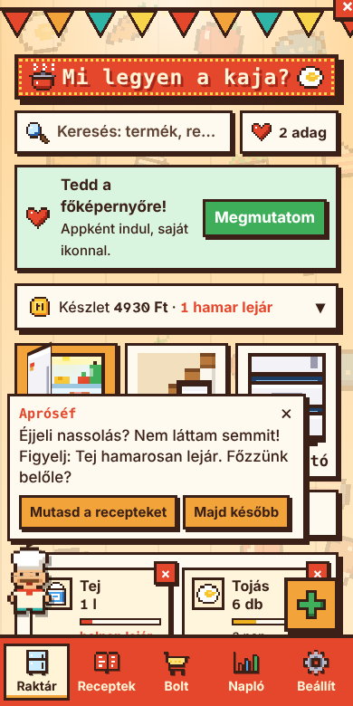
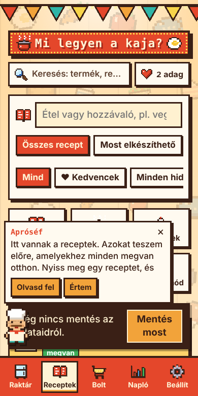
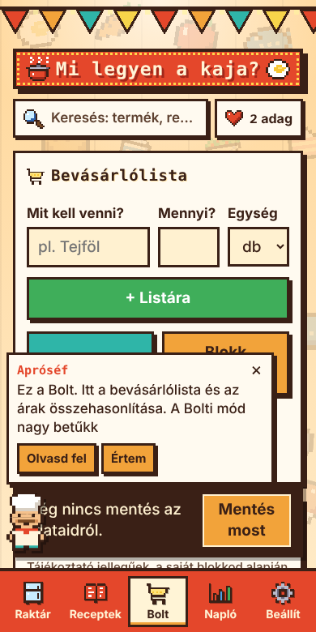

[🇬🇧 English](README.md) · 🇭🇺 Magyar

# Mi legyen a kaja?

Retro pixel art családi étkezéstervező: mi van otthon a hűtőben, a spájzban és a fagyasztóban, mit főzhetsz belőle, és mennyibe kerül.



### [▶ Játék indítása](https://strattila90-hue.github.io/mi-legyen-a-kaja-/) · [📱 APK letöltése](https://github.com/strattila90-hue/mi-legyen-a-kaja-/releases/download/apk-latest/mi-legyen-a-kaja.apk)

    

## Funkciók
- **Raktár**: hűtő, spájz, fagyasztó, lejárati dátumokkal és "hamar lejár" figyelmeztetéssel.
- **Receptek** a meglévő készlethez igazítva, a háztartás (felnőtt, kamasz, gyerek, kisgyerek) szerint átszámolva.
- **Bevásárlólista és árösszehasonlítás** boltok között, bolti mód, vonalkód.
- **Keret és napló**: napi keret, kiadások, havi statisztika, pazarlás-statisztika, kitűzők.
- **Heti menü**, kedvencek, ki mit nem eszik, maradék, szezon- és ünnepi ötletek.
- **Főzés mód** és a beszélő pixel séf (Apróséf) viccekkel, tippekkel.
- **Közös raktár** a családnak Firestore-ral (opcionális, saját Firebase beállítás kell).
- **Mentés és visszatöltés** fájlba vagy szövegként; világos, sötét és automatikus esti téma.
- **Offline** is működik (service worker), PWA-ként telepíthető, Android appként (TWA) is.

## Képernyőképek
  

## Futtatás helyben
Nincs build lépés és csomagkezelő.
```bash
git clone https://github.com/strattila90-hue/mi-legyen-a-kaja-.git
cd mi-legyen-a-kaja-
python3 -m http.server 8808
# http://localhost:8808/
```
Az adatok a böngészőben (`localStorage`) maradnak, kivéve ha bekapcsolod a közös raktárt.

## Technika
Sima JavaScript, HTML és CSS, kódból rajzolt pixel art, PWA (service worker, manifest), opcionális Firebase Firestore szinkron, Tesseract.js blokk-OCR, Android app Bubblewrappel (TWA) GitHub Actionsben építve.

## Közreműködés
Issue-kat és pull requesteket szívesen fogadunk, lásd [CONTRIBUTING.md](CONTRIBUTING.md).

## Licenc
[MIT](LICENSE)

⭐ Ha tetszik, adj neki egy csillagot, sokat segít!
