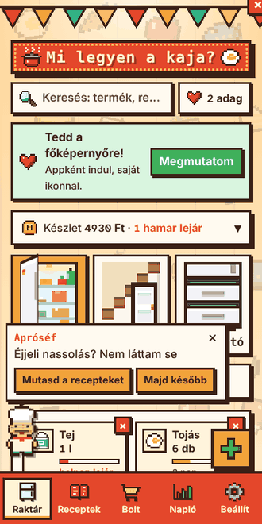
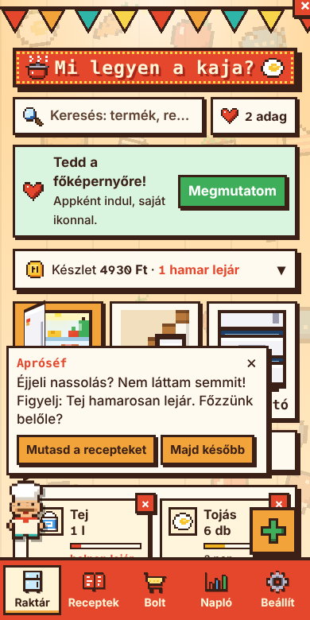
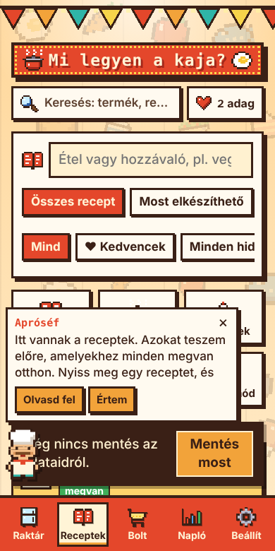
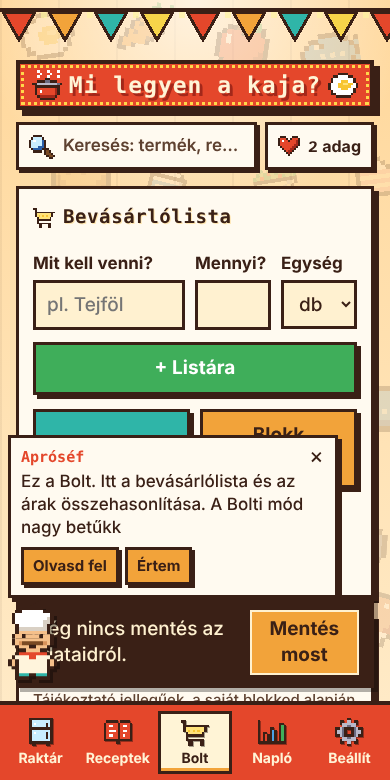

🇬🇧 English · [🇭🇺 Magyar](README.hu.md)

# Mi legyen a kaja? ("What's for dinner?")

A retro pixel-art family meal planner: track what is in the fridge, pantry and freezer, see what you can cook from it, and keep an eye on the budget.



### [▶ Play now](https://strattila90-hue.github.io/mi-legyen-a-kaja-/) · [📱 Download APK](https://github.com/strattila90-hue/mi-legyen-a-kaja-/releases/download/apk-latest/mi-legyen-a-kaja.apk)

    

> The interface is in Hungarian.

## Features
- **Stock** of fridge, pantry and freezer, with expiry dates and a "sells soon" warning.
- **Recipes** matched against what you have at home, scaled to your household (adults, teens, kids, toddlers).
- **Shopping list and price comparison** between shops, plus a shop mode and barcode scanning.
- **Budget and meal log**: daily budget, spending, monthly stats, waste statistics, badges.
- **Weekly menu**, favourites, dietary filters (who does not eat what), leftovers and seasonal / holiday ideas.
- **Cooking mode** and a talking pixel chef ("Apróséf") with jokes and tips.
- **Shared pantry** for the family via Firestore (optional, needs your own Firebase config).
- **Backup and restore** to a file or as text; light, dark and automatic night theme.
- Works **offline** (service worker), installable as a PWA, Android app as a TWA.

## Screenshots
  

## Run locally
There is no build step and no package manager.
```bash
git clone https://github.com/strattila90-hue/mi-legyen-a-kaja-.git
cd mi-legyen-a-kaja-
python3 -m http.server 8808
# open http://localhost:8808/
```
All data stays in the browser (`localStorage`) unless you enable the shared pantry.

## Tech
Vanilla JavaScript, plain HTML and CSS, pixel-art sprites drawn from code, PWA (service worker, web manifest), Firebase Firestore for optional sync, Tesseract.js for receipt OCR, Android app built with Bubblewrap (TWA) in GitHub Actions.

## Contributing
Issues and pull requests are welcome, see [CONTRIBUTING.md](CONTRIBUTING.md).

## License
[MIT](LICENSE)

⭐ If you like it, please give it a star — it really helps!
